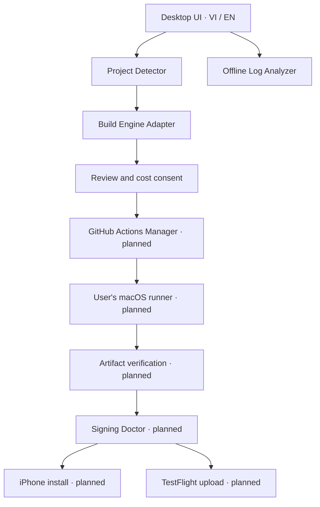

# Architecture

## User story and boundaries

A Windows developer selects a Flutter folder, receives local inspection findings, reviews an immutable build request and estimated cost, approves a GitHub workflow run, then downloads and verifies its actual output. Later milestones validate signing, install on a trusted iPhone, and upload to TestFlight with accurate processing/review states.

The present foundation implements the first inspection and draft-generation boundaries plus offline diagnostics. It does not make remote requests on behalf of the developer.

Solid arrows describe intended dependencies, not proof that the remote stages are implemented. In the current implementation, the adapter returns a workflow string only.

## Module contracts

| Module | Responsibility and native boundary | Present state |
| --- | --- | --- |
| Project Detector | Read allowlisted metadata under selected root; structured findings, no arbitrary command execution | TypeScript parser tested; native reader source awaits Rust/Windows validation |
| Build Engine Adapter | Validate configuration and prepare workflow/output contract | Unsigned GitHub/macOS draft implementation; no local compiler |
| GitHub Actions Manager | Selected-repo auth, optimistic workflow write, dispatch, correlation, polling, cancellation | Design only; no token input or fake connection |
| Signing Doctor | Match bundle/team/certificate/profile/entitlements/expiry/export method | Planned; metadata inspection must not be presented as signature verification |
| iPhone Device Manager | Driver and service detection, trusted USB, Developer Mode, signed installation | Planned; tool/version/license and real hardware gates |
| IPA Artifact Manager | Run/source association, download/digest, bounded ZIP/IPA validation | Evidence schema/validator only; no downloader |
| TestFlight Assistant | API key permissions, app/version/build checks, upload, processing/review states | Planned; upload does not imply Apple approval |
| Build Log Analyzer | Local redaction, rules and bilingual actionable findings | Implemented with scenario tests; no cloud calls |
| Settings & Localization | Language/theme only in local preferences | Implemented, browser persistence verified separately |

## Data and authority

The renderer receives `ProjectFile { path, content }` only for `pubspec.yaml`, `pubspec.lock`, `ios/Podfile`, `ios/Runner.xcodeproj/project.pbxproj` and `ios/Runner/Info.plist`. Both readers bound each metadata file. Rust selects the folder itself; there is no IPC command that lets the renderer pass an arbitrary root. Resolved native paths must stay beneath the selected root. Static inspection cannot prove dependency/native plugin compatibility or resolve Xcode variable-expanded bundle IDs.

The core never executes processes or imports OS credential APIs. `BuildEngineAdapter.prepare()` is pure text generation. A later native orchestration service owns network calls and credential references, never exposes long-lived credential values for renderer storage, and maps failures to structured error codes. Do not pass secrets as command-line arguments.

Projects/findings/logs are in memory. This foundation persists only language and theme. History will need a versioned local schema containing run references/status/tool versions and sanitized findings, never secrets or unsanitized log archives.

## GitHub integration plan

Use repository-selected GitHub App authorization when feasible; a user-created fine-grained PAT restricted to the selected repository may be an explicit advanced fallback. Store its secret through Windows Credential Manager. A plain OAuth device grant with classic `repo` scope is not a least-privilege replacement. App credentials and public client registration require their own setup decision; none is invented in source.

Minimum permissions by operation: metadata/contents read for import, Actions read for monitoring/artifacts; Actions write for dispatch/cancel; Contents write plus Workflows write only for approved workflow changes. Confirm the exact operation's current GitHub permissions before implementation. Installation access and repository selection must be revocable; a disconnect removes the local credential and links to GitHub revocation settings.

Read current workflow contents/SHA, display a diff and target account/repo/ref/path, then write with optimistic concurrency. A changed SHA invalidates approval. Dispatch uses an immutable reviewed source commit and reviewed workflow revision. Bind cost/trust approval to that tuple and runner; require fresh consent when it changes. No automatic push, publication, visibility change or billing update.

Network calls need timeout, cancellation and bounded retry for idempotent reads (respect `Retry-After`). Do not blindly repeat ambiguous dispatch/upload mutations. Correlate a unique request marker with run metadata and distinguish queued, running, cancelled, timed out, failed and successful states. Do not synthesize progress percentages from elapsed time.

Artifact redirects are followed without forwarding bearer credentials to the download host. Validate the resulting archive, expected GitHub origin/run, expiry, size/digest and path limits before extraction. Store a hash of the downloaded file and check the internal executable, not just the extension.

## Build lanes

The initial draft is manual `workflow_dispatch`, limited to standard `macos-15`/`macos-26`, with runtime 5–60 minutes and retention 1–7 days (default one). It records Flutter/Xcode versions, runs `flutter build ios --release --no-codesign`, requires a real arm64 Mach-O output, packages `.app` with `ditto`, creates SHA-256 and uses fail-on-missing artifact upload. A successful workflow is not currently claimed or observed.

The Flutter action SHA is pinned and cache disabled; downstream/transitive action/source audit remains a release requirement. Exact Flutter version syntax is checked, not its availability or suitability. The OS label does not pin the runner image or Xcode version: capture the actual versions and establish a tested matrix.

Signed lanes are deliberately rejected by the generator today. The next implementation imports a matching certificate/private key and provisioning profile into an ephemeral macOS keychain, checks trust/expiry/bundle/team/entitlements, runs Flutter archive/export with an explicit export method and verifies the resulting IPA signature. Clean temporary assets even on failures. Prefer API-key-based App Store Connect work and avoid collecting Apple ID passwords.

## Verification matrix

| Boundary | Required evidence |
| --- | --- |
| Parser/security/core | Scenario tests for real failure patterns, malicious metadata/paths and false-success prevention |
| UI | Production browser import → findings → workflow generation/download; invalid config; offline diagnosis; locale/theme; console/network errors |
| Windows native | OS/tool versions, Cargo.lock, fmt/test/clippy, native dialog/drop/IPC, installer build/install/launch |
| macOS compile | Real run ID, immutable source SHA, Flutter/Xcode/image versions, logs and nonempty executable artifact downloaded/hashed |
| Signed IPA | Certificate/profile validity and signature verification, matching run/source, actual IPA payload |
| Device | Real iPhone/iOS/driver/trust/Developer Mode and installation/launch, identifiers kept private |
| TestFlight | Actual upload response, build association and processing status; review/approval reported separately |

The acceptance evidence schema rejects missing run IDs, digests, payload inspection, failed conclusions and unverified signed IPA signatures. Supplying a schema object alone is not proof that its claims are authentic: the future verifier must populate it from actual API/download/signature checks.
